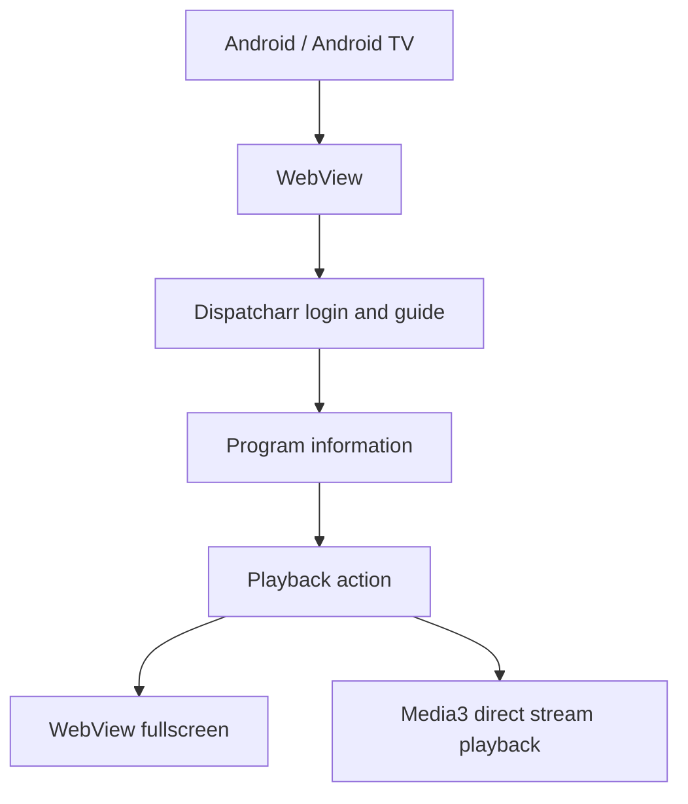

<div align="center">

# Guide Client

**An unofficial Dispatcharr guide and live TV client for Android and Android TV.**

[](https://github.com/lamb0985/guide-client/actions/workflows/build.yml)
[](LICENSE)


[Download builds](https://github.com/lamb0985/guide-client/actions) · [Report an issue](https://github.com/lamb0985/guide-client/issues) · [Dispatcharr upstream](https://github.com/Dispatcharr/Dispatcharr)

</div>

## Overview

Guide Client provides a dedicated live TV experience using your existing Dispatcharr server. It displays the original electronic program guide (EPG), authentication interface and program information, with Android playback integration. No changes to the Dispatcharr container, additional server components or replacement EPG database are required.

## Features and development status

| Feature | Status |
| --- | --- |
| Existing Dispatcharr login and guide | Implemented; live-server testing pending |
| Configurable server address | Implemented |
| Persistent WebView session storage | Implemented |
| Original program information popups | Uses server-rendered interface |
| Full-screen WebView playback | Implemented; device testing pending |
| Native Media3 / ExoPlayer | Direct stream navigation supported in code; guide handoff unverified |
| Android TV launcher | Implemented |
| Remote / D-pad navigation | Dedicated guide tile navigation; device verification pending |
| Guide-only layout | Administrative sidebar hidden and routes restricted in the client |
| Automated APK builds | GitHub Actions workflow included |
| Server modifications | Not required by design |

**Development status:** Early prototype (v0.1.1). v0.1.0 compiled successfully and login was confirmed on a device; guide navigation fixes in v0.1.1 require device verification.

## Getting started

### Requirements

- Android 6.0 (API 23) or newer, or compatible Android TV device.
- A reachable Dispatcharr installation and valid credentials.
- Permission to access the channels and content configured on that server.

### Installation

1. Visit the [Actions page](https://github.com/lamb0985/guide-client/actions).
2. Select a successful **Build Android APK** run, if available.
3. Download the `guide-client-debug` artifact and extract the APK.
4. Install the APK on your Android device using your preferred sideloading method.

Debug builds are intended for testing, not production distribution. No verified APK release is currently promised.

### Usage

1. Launch Guide Client and enter the base URL of your Dispatcharr server (for example, `http://192.168.1.15:9191`).
2. Sign in using the original Dispatcharr authentication interface.
3. Use Up/Down to change channels, Left/Right to select programs, and OK to open the original program popup. The guide receives initial focus and selected tiles have a teal outline.
4. Use its playback action to watch the channel. Press Back to exit full-screen playback.

The hardware Menu key opens server configuration when available. Exact navigation and playback behavior depend on the server version and Android device.

## Architecture



The guide and authentication are provided by the existing Dispatcharr instance. Guide Client wraps that interface and adds local Android playback functionality.

## Build from source

Requirements: JDK 17, Android SDK 35 and Gradle 8.9.

```bash
git clone https://github.com/lamb0985/guide-client.git
cd guide-client
gradle assembleDebug
```

Output: `app/build/outputs/apk/debug/app-debug.apk`.

## Security and privacy

The app connects to the server you configure and uses Android WebView session storage. It does not implement a separate account service or analytics SDK. The upstream web interface and server may have their own data handling behavior. HTTP traffic is unencrypted; use a trusted HTTPS endpoint for remote access. Only install APKs from sources you trust.

## Contributing

Issues and pull requests are welcome. Include your Android version, device type, Dispatcharr version and reproducible steps when reporting problems. Redact credentials, tokens and private stream URLs.

## Credits and legal

- **Dispatcharr:** The original guide, authentication, program metadata and streaming services are provided by [Dispatcharr](https://github.com/Dispatcharr/Dispatcharr) and its contributors. Upstream is licensed under GNU AGPL v3.
- **AndroidX Media3 / ExoPlayer:** Android playback libraries provided by Google and contributors under Apache License 2.0.
- Guide Client is an independent, unofficial project. It is not affiliated with, sponsored by or endorsed by Dispatcharr or Google. Names are used descriptively to identify compatible software.

Guide Client does not provide channels, subscriptions, playlists or copyrighted programming. Users are responsible for lawful access and use of their own server and content.

## License

Guide Client is licensed under the **GNU Affero General Public License, version 3 only (AGPL-3.0-only)**. See [LICENSE](LICENSE) for the complete terms and [THIRD_PARTY_NOTICES.md](THIRD_PARTY_NOTICES.md) for dependency attribution. The software is provided without warranty, as described in the license.
